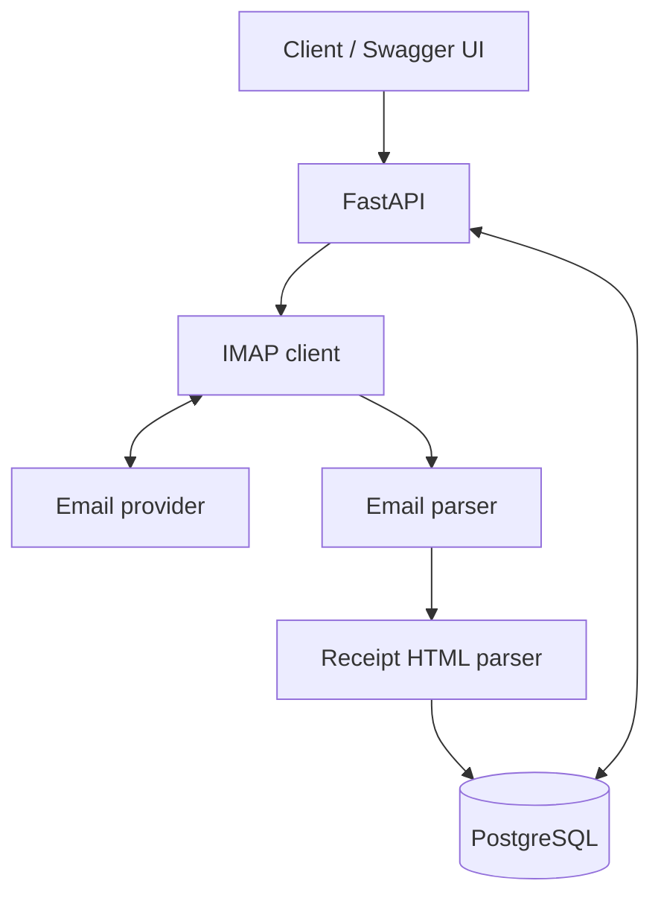

# Receipts Analyzer
Receipts Analyzer is a backend application for collecting and analyzing electronic receipts received via email.
The application retrieves emails using IMAP, extracts receipt HTML content, parses purchase information, and stores the results in PostgreSQL.

### Features
- Retrieve electronic receipts from email via IMAP
- Parse receipt HTML using BeautifulSoup and extract purchase information, including product names, quantities, and prices
- Store parsed receipts in PostgreSQL
- Provide access to receipt data through a FastAPI REST API

### Архитектура



### Tech Stack
Python, FastAPI , PostgreSQL , SQLAlchemy , Alembic , Pydantic , IMAP , BeautifulSoup, Uvicorn 

## Getting Started Locally

**Requirements**: Python 3.13, PostgreSQL, git, access credentials to IMAP mailbox connection.

### 1. Clone the Repository

```bash
git clone https://github.com/nuts-ilyam/receipts-analyzer.git
cd receipts-analyzer
```

### 2. Environment Configuration
```bash
python -m venv .venv
```
Env Activation 

**Windows**
```bash
.venv\Scripts\activate
```
Dependencies installation 
```bash
pip install -r requirements.txt
```
Create `.env` file and copy data from `env.example` file.
```
db connection variables
DB_HOST=
DB_PORT=
DB_NAME=
DB_USER=
DB_PASSWORD=

imap authentication variables
IMAP_USER= #User email
IMAP_PASSWORD= #Use an App Password here, NOT your login password
IMAP_HOST= #IMAP host of email provider (Common hosts: 'imap.gmail.com', 'imap.mail.yahoo.com', '://office365.com')
```

## 3. Database creation
```sql
CREATE DATABASE receipts_db;
```
Be sure PostgreSQL is running and connection variables in `.env` are correct.

## 4. Run migrations
In Shell
```shell
alembic upgrade head 
```
It applies all available alembic migrations and updates database schema to 
the up-to-date state.

## 5. Run application via Uvicorn

```shell
uvicorn main:app --reload
```
Swagger UI: http://localhost:8000/docs